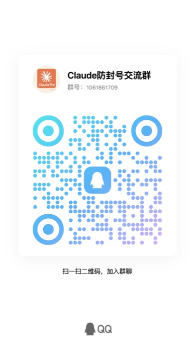

# Claude 防封指南（claude-fangfeng）

> 🌐 **在线阅读：[https://claucc.net](https://claucc.net)** —— 排版更好、内容最新，支持站内搜索和中英文切换。本仓库是网站文章的 Markdown 版。

Claude / Claude Code 总被封号？这里整理了一套实测过的做法：风控到底在查什么、用之前怎么把电脑和网络检测干净、怎么用指纹浏览器给账号建专属环境、被封以后怎么清理重来，以及 Claude Code 在真实项目里的用法。

## 从哪开始

| 你的情况 | 先看 |
|---|---|
| 第一次用 Claude，想一次做对 | [Claude 注册到使用全流程](docs/claude/claude-usage.md) |
| 账号总被封，想知道为什么 | [Claude 防封避坑清单](docs/claude/claude-anti-ban.md) |
| 用之前先把电脑和网络查一遍 | [使用 Claude 前的电脑检测](docs/claude-clean/claude-pc-checkup.md)、[检测地址汇总](docs/claude-clean/claude-check-sites.md) |
| 已经被封，想清理后重新注册 | [清理设备指纹、重新注册](docs/claude/claude-clean-fingerprint-reregister.md) |
| 想在项目里用好 Claude Code | [Claude Code 开发教程](docs/claude-code/cc-01-install.md) |

## 目录

### Claude 防封清理与指纹浏览器

用 Claude 前把电脑检测干净、首次登录怎么起步、用 AdsPower 给账号建专属环境，被封后怎么清理重来。　[在线阅读](https://claucc.net/topics/claude-clean)

**检测与清理**

- [使用 Claude 前的电脑检测：五步把环境做干净](docs/claude-clean/claude-pc-checkup.md)
- [网络环境检测地址汇总（附代理配置要点）](docs/claude-clean/claude-check-sites.md)
- [首次登录必看：清理残留、改邮箱密码、循序渐进使用](docs/claude-clean/claude-first-login.md)

**指纹浏览器**

- [用 AdsPower 给 Claude 建一个专属浏览器环境](docs/claude-clean/claude-adspower-profile.md)

**防封 / 风控指南**

- [被封号后如何清理设备指纹、重新注册不再被封(新手一篇搞定)](docs/claude/claude-clean-fingerprint-reregister.md)
- [指纹浏览器 + 独享住宅 IP:多号隔离怎么做](docs/claude/fingerprint-browser-isolation.md)
- [AdsPower 指纹浏览器配合独享 socks5:完整配置](docs/claude/adspower-socks5-setup.md)
- [从 0 配好第一个隔离环境](docs/claude/multi-account-setup.md)

**环境检测 / 排查**

- [注册前环境自检:IP 质量与泄露检测](docs/claude/ip-quality-check.md)
- [DNS / WebRTC 泄露检测](docs/claude/dns-leak-check.md)

### Claude / ChatGPT 注册、订阅与防封

Claude / ChatGPT / Codex 的注册、订阅、使用与防封全流程。　[在线阅读](https://claucc.net/topics/ai)

**为什么要用住宅 IP**

- [用 ChatGPT 为什么要用住宅 IP](docs/claude/chatgpt.md)
- [为什么住宅 IP 至关重要](docs/claude/residential-ip.md)
- [伪住宅 IP:Comcast 与 NTT / GTT 的区别](docs/claude/fake-residential-ip.md)

**注册 / 订阅 / 上手**

- [Claude 注册到使用全流程(从零开始)](docs/claude/claude-usage.md)
- [如何注册一个美区 Apple ID(无需信用卡)](docs/claude/apply-us-apple-id.md)
- [没有信用卡,也能给苹果账户充美元余额](docs/claude/apple-giftcard-topup.md)
- [苹果手机怎么下载小火箭(Shadowrocket)](docs/claude/iphone-download-shadowrocket.md)
- [Claude 苹果礼品卡订阅全流程(美区 · 手机图文)](docs/claude/claude-subscription.md)
- [ChatGPT 与 Codex:注册、订阅、防封](docs/claude/chatgpt-register.md)

**防封 / 风控指南**

- [被封号后如何清理设备指纹、重新注册不再被封(新手一篇搞定)](docs/claude/claude-clean-fingerprint-reregister.md)
- [Claude 防封避坑清单:封号原理与对策一篇讲透](docs/claude/claude-anti-ban.md)
- [指纹浏览器 + 独享住宅 IP:多号隔离怎么做](docs/claude/fingerprint-browser-isolation.md)
- [AdsPower 指纹浏览器配合独享 socks5:完整配置](docs/claude/adspower-socks5-setup.md)
- [从 0 配好第一个隔离环境](docs/claude/multi-account-setup.md)

**使用技巧 / 进阶**

- [ChatGPT「降智」:为什么变笨、为什么回答 mini](docs/claude/chatgpt-downgrade-mini.md)

**进阶配置**

- [Claude Code 安装与联网配置](docs/claude/claude-code-setup.md)
- [推荐 MCP 与 Skills:安装与使用](docs/claude/mcp-skills.md)
- [VSCode 里用上 Claude 和 GPT:插件全方案](docs/claude/vscode-ai-plugins.md)
- [用 cc-switch 让 Claude Code 切换其他厂家模型](docs/claude/cc-switch.md)

**环境检测 / 排查**

- [注册前环境自检:IP 质量与泄露检测](docs/claude/ip-quality-check.md)
- [DNS / WebRTC 泄露检测](docs/claude/dns-leak-check.md)
- [测速与延迟诊断](docs/claude/speed-test.md)
- [切号 / 登录前环境自检(通用)](docs/claude/switch-account-checkup.md)

### Claude Code 开发教程

在真实项目里用 Claude Code 把活干完：上手、读代码、先出方案、子代理与 Skills、测试验证、实战复盘、成本控制。　[在线阅读](https://claucc.net/topics/claude-code)

**上手**

- [01 · 安装与第一个项目](docs/claude-code/cc-01-install.md)
- [02 · 读懂一个陌生代码库](docs/claude-code/cc-02-read-codebase.md)

**开发工作流**

- [03 · 先出方案再写代码](docs/claude-code/cc-03-plan-first.md)
- [04 · 子代理与 Skills](docs/claude-code/cc-04-subagents-skills.md)
- [05 · 测试与自动化验证](docs/claude-code/cc-05-testing.md)

**实战复盘与进阶**

- [06 · 实战复盘：一天做完 AI 报告 HTML 3D 组件](docs/claude-code/cc-06-case-study.md)
- [07 · 上下文与成本控制](docs/claude-code/cc-07-context-cost.md)

**自建 API 网关**

- [sub2api 搭建教程：自建 Claude Code / Codex API 网关](docs/claude-code/sub2api-deploy.md)

## 交流

有问题欢迎加 QQ 群交流：**1061861709**

不想自己注册和配环境，可以用 [Claude Code 中转服务](https://claucc.net/cc-relay)（按量计费，0.35 倍率）；团队想自建 API 网关，看 [sub2api 搭建教程](docs/claude-code/sub2api-deploy.md) 或了解 [sub2api 搭建服务](https://claucc.net/sub2api-service)。

## 说明

- 文章由 [claucc.net](https://claucc.net) 自动导出，网站更新后这里会同步，内容以网站为准。
- 内容是个人实测经验，平台风控规则一直在变，仅供参考。请遵守 Anthropic / OpenAI 的服务条款和当地法律法规。

## 许可证

本仓库内容采用 [CC BY-NC-SA 4.0](LICENSE)（署名-非商业性使用-相同方式共享）许可：可以转载和改编，但要注明出处 [https://claucc.net](https://claucc.net)，不能用于商业用途，改编后的作品也要用同样的许可证发布。
