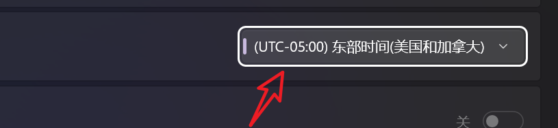

# 使用 Claude 前的电脑检测：五步把环境做干净

> 原文地址：[https://claucc.net/articles/claude-pc-checkup](https://claucc.net/articles/claude-pc-checkup)　·　更多教程见 [claucc.net](https://claucc.net)

新电脑、换过号的电脑、团队成员的电脑，第一次用 Claude 之前都按这五步过一遍：守住三条红线、清理旧痕迹、改时区、屏蔽网页端、换 IP 并逐项检测。

## 先守住三条红线

> [!CAUTION]
> **这三条做不到，后面的步骤都白做**：
>
> 1. **不用普通浏览器打开 claude.ai**。网页端统一放进指纹浏览器里用（见[用 AdsPower 建 Claude 专属环境](claude-adspower-profile.md)），日常浏览器里一次都别登。
> 2. **只用美国家庭宽带 IP，不切别的节点**。把代理软件里其他订阅都删掉，免得哪天手滑切到机房节点，一次就可能留下记录。
> 3. **这条线路不拿来下载大文件**。住宅 IP 只用来访问 Claude，大流量下载会让这条线路看起来不像普通家庭用户。

## 第一步：清理 Claude 旧痕迹

如果这台电脑以前登过 Claude、或者出过封号，先把本地残留清干净：登录状态、Token、缓存、配置文件。最省事的办法是让另一个 AI 编程工具（比如 Codex）替你清，指令直接复制：

```bash
帮我清理当前电脑所有 Claude / Claude Code / Anthropic 相关缓存、登录状态、Token、配置及本地残留，不要删除项目和个人文件。
```

> [!WARNING]
> 清理前先备份重要文件。清完检查一遍它删了哪些目录，确认没有误删项目代码。想手动清、或想知道具体有哪些目录，看[被封号后如何清理设备指纹](../claude/claude-clean-fingerprint-reregister.md)。

## 第二步：把系统时区改成美国

时区要和 IP 所在地一致。IP 在美国东部，就选「(UTC-05:00) 东部时间（美国和加拿大）」；Mac 在「系统设置 → 通用 → 日期与时间」里关掉自动设置时区，再手动选纽约。



*图：Windows 设置里把时区选成美国东部时间*

改完之后电脑右下角、手机闹钟的时间都会变，这是正常的。**改了就别再改回去**，时区一会儿美国一会儿北京，比一直不改更可疑。

## 第三步：日常浏览器装 BlockSite，屏蔽 claude.ai

红线第一条靠自觉很容易破功：搜个资料随手点进 claude.ai，日常浏览器的真实指纹就和账号连上了。给 Chrome / Edge 装扩展 **BlockSite**，把下面这个网址加进黑名单：

```bash
https://claude.ai
```

这样日常浏览器永远打不开 Claude 网页端，只有指纹浏览器里的专属环境能打开。

## 第四步：换上美国家宽 IP，逐项检测

代理软件只保留美国家宽订阅，打开 **TUN 模式 + 全局**，然后依次打开下面三个检测站：

[Claude 专项检测

ip.net.coffee/claude

信任评分、三个出口 IP、DNS 和 WebRTC 泄露，最重要](https://ip.net.coffee/claude/)
[IP 类型与风控值

ping0.cc

看是不是家庭宽带、风控值、共享人数](https://ping0.cc)
[纯净度与泄露

ippure.com

IP 属性、纯净度系数、WebRTC / DNS 泄露](https://ippure.com)

### 合格标准（ip.net.coffee/claude）

> *示意界面（ip.net.coffee/claude/）*：
>
> Claude AI IP 风险检测（示意，IP 已打码）
>
> | 项目 | 说明 |
> | --- | --- |
> | 中国出口 IPv4 | xx.xx.xx.xx · Comcast Cable |
> | Cloudflare 出口 IP | xx.xx.xx.xx · Comcast Cable |
> | Claude AI 出口 IP | xx.xx.xx.xx · Comcast Cable |
> | AI 信任评分 | 95 · 极度纯净 |
> | IP 属性 | 家庭住宅 IP |
> | VPN / 代理 / Tor | 均未检测到 |
> | DNS 泄露 | 未检测到 · 出口在美国 |
> | WebRTC 泄露 | 已禁用或无泄露 |
> | 时区 | 一致 · America/New\_York |

1. **信任评分越高越好，建议 90 分以上**，IP 属性必须是住宅，不能是机房。评分低说明线路本身不行，换线路，别硬上。
2. **第一行三个 IP 必须一样**。三个不一样，说明有的流量没走代理，Claude 可能从其中一个看到你的国内 IP。
3. **DNS 泄露里不能出现中国**。出现了，基本都是没开 TUN 或没开全局，打开再测。

### ping0.cc 和 ippure.com 看什么

| 项目 | 说明 |
| --- | --- |
| IP 类型 / IP 属性 | 家庭宽带 IP · 住宅 IP |
| ASN 所有者 | Comcast / AT&T 这类家宽运营商 |
| 风控值 / 纯净度系数 | 越低越好，个位数最佳 |
| 原生 IP | 是 |
| 共享人数 | 1–10（越少越好） |

### 两项泄露单独再测一遍

下面两个页面结果里**不能出现中国**（STUN 服务器那一列标着 China 没关系，看的是检测结果是不是「未检测到泄露」，以及 DNS 出口是不是都在美国）：

- WebRTC 泄露：[ippure.com/Browser-WebRTC-Leak-Detect](https://ippure.com/Browser-WebRTC-Leak-Detect)
- DNS 泄露：[ippure.com/DNS-Leak-Detect](https://ippure.com/DNS-Leak-Detect)

## 检测不过怎么办

| 项目 | 说明 |
| --- | --- |
| 三个出口 IP 不一样 | 打开 TUN + 全局，重开浏览器再测 |
| DNS 里出现中国 | 同上；还不行就关掉系统 IPv6 |
| 信任评分低 / 显示机房 | 线路问题，换美国家宽线路 |
| 时区不一致 | 回到第二步改系统时区 |
| 语言不一致（zh-CN） | 指纹浏览器里设成基于 IP |

全部通过后，再按[首次登录必看](claude-first-login.md)的节奏登录和使用。

---

有问题欢迎加 QQ 群 **1061861709** 交流，最新版本以 [claucc.net](https://claucc.net/articles/claude-pc-checkup) 为准。
