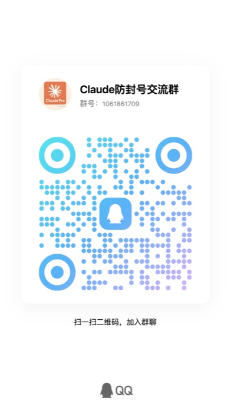

# Claude 防封避坑清单:封号原理与对策一篇讲透

> 原文地址：[https://claucc.net/articles/claude-anti-ban](https://claucc.net/articles/claude-anti-ban)　·　更多教程见 [claucc.net](https://claucc.net)

先用 **1 分钟自查清单**对一遍自己的环境,再按需往下看:风控到底在看什么(设备指纹、注册来源、支付、关联图谱各占多大分量,成品号为什么一登录就封)、注册和登录怎么做才干净、日常有哪些红线,以及**已经出问题了怎么查、被封了怎么干净重来**。

> [!CAUTION]
> 两条铁律:**① 第一次绝对不要用机房 IP(VPS 直连)注册**,被记录后换住宅 IP 也很难洗白;**② 别买「成品号」**(别人批量注册打包卖的现成账号),近期常常一登录就 disabled,原因见 [为什么成品号总是一登录就封](#为什么最近成品号总是一登录就封)。稳的唯一路是干净环境自己注册、自己养。

## 1 分钟自查清单

封号几乎都栽在下面这几项上。逐行对一遍,红色那栏只要中了一条,就先改掉再用:

| 项目 | 要这样做 | 千万别 | 详解 |
| --- | --- | --- | --- |
| 出口 IP | 固定一条美国**住宅** IP,一号一 IP | 机房 IP 起手;频繁切节点;多人共用一个出口 | [为什么住宅](residential-ip.md) |
| 设备指纹 | 多号用**指纹浏览器**,一个环境一个号,指纹固定不变 | 同一浏览器换 Profile / 无痕就以为隔离了;开「随机指纹」 | [AdsPower 配置](adspower-socks5-setup.md) |
| 时区 | 系统时区改成和 IP 一致的美区(用桌面端 / Claude Code 必须改) | 改完又改回北京时间;老号突然改 | [改时区步骤](claude-clean-fingerprint-reregister.md) |
| 登录方式 | 输入邮箱 → Continue with email,登录邮件在**同一个环境**里打开 | 点「使用 Google 登录」;在手机或日常浏览器里点登录链接 | [指纹浏览器登录](claude-clean-fingerprint-reregister.md) |
| 手机 App | 确认 App 的流量真的走了代理(代理软件连接列表里能看到 claude.ai) | 只看手机浏览器显示美国 IP 就放心 | [手机端](#三手机端先确认-app-真的走了代理) |
| 支付 | 一号一卡;新号先养 3–5 天再订阅 | 一张卡绑多个号;注册当天就付费;支付地区和账号地区对不上 | [订阅支付](#四订阅支付别让钱把号连成一串) |
| 日常习惯 | 固定设备、固定 IP、像真人一样用 | 多人、多地同时登录;一登录就满负载跑脚本 | [日常红线](#五日常使用的红线) |
| 泄露 | 定期查 DNS / WebRTC 泄露 | 真实 IP 从侧信道漏出去,前面全白做 | [泄露检测](dns-leak-check.md) |

*图:防封自查清单——把「千万别」那栏全部避开,封号概率就压到最低*

## 风控到底在看什么:封号的原理

一句话:**设备指纹和注册来源分量最重,支付其次,出口 IP 是及格线**(不达标直接拦,达标了也救不了脏号),再用「关联图谱」把共用过设备、卡、来源的账号连成一张网——**一个号被判坏,整串跟着连坐**。

注册被拒、反复验证、封号,其实是**同一套打分**在不同环节给出的结果。所以**预防就是把分数拉高,诊断就是找出分数被什么拉低了**。下面把每个维度拆开讲清楚,后面几节再讲具体怎么做。

你每次注册或登录,平台不会只问「这个 IP 干不干净」,而是把下面这些信号一起喂进风控模型,算出一个风险分,再决定放行、要验证、还是直接封。

设备指纹 （你这台机器长什么样） → 注册来源 （这个号怎么来的） → 行为模式 （用起来像不像真人） → 支付信息 （绑的什么卡） → 出口 IP （及格线,不达标直接拦） → 关联图谱 （把上面全部连成一张网打分） → 结果 （通过 / 验证 / 封号）

*图:出口 IP 只是输入之一,真正决定生死的是这些信号连成的关联图谱*

### 各信号的分量:IP 排最后,但它是及格线

为什么说「换 IP 救不了号」?因为在风控眼里,IP 是最容易更换的信号,在「区分是不是同一个人」上分量很低;而设备、来源、支付这些「换起来代价高」的维度,才是主力。下面是各信号在封号决策里的大致分量(示意):

设备指纹极高

注册来源极高

支付信息高

行为模式中

出口 IP及格线

*图:IP 分量最低,但它是及格线——不能用机房 IP,不达标一票否决;达标之后看的是上面几项(示意)*

> [!TIP]
> 换句话说:干净的住宅 IP 是「及格线」,不达标一票否决;但达标之后,能不能活下去,取决于上面权重更高的那几项。

### 维度一:设备指纹(Device Fingerprint)

不靠 IP,而是靠你这台设备本身凑出一个几乎唯一的标识。平台用几十个弱特征组合起来,重合概率极低——所以同一台电脑上登十个号,就算每个号换 IP,指纹一样,平台知道是同一个人。

| 采集项 | 为什么能识别你 |
| --- | --- |
| Canvas / WebGL 指纹 | 同一段绘图指令,不同显卡 / 驱动渲染出的像素有细微差别 |
| 字体列表 | 你装了哪些字体,组合几乎唯一 |
| 屏幕分辨率 / 时区 / 语言 | 与你声称的所在地对不上就扣分 |
| 音频指纹 / 硬件并发数 | 硬件层面的细微差异,难以伪造 |

**要点**:换 IP 不换设备指纹,等于换了件衣服但还是同一张脸。多号隔离必须用独立指纹浏览器或独立设备。被封过再重注时怎么换,见 [清理设备指纹重注](claude-clean-fingerprint-reregister.md)。

### 维度二:账号注册来源(Registration Provenance)

这个号「怎么来的、在哪出生的」。注册那一刻的环境会被永久记在账号档案里,登录时哪怕环境再干净,出生记录洗不掉。

✓ 干净出生

住宅 IP 注册  
真实独立邮箱  
非批量、非集中时间  
指纹一致

✕ 出生即脏

机房 IP 批量注册  
临时 / 批量域名邮箱  
同一分钟生成一批  
虚拟号验证

*图:成品号的死穴——它出生那一刻的来源就脏,后期无论怎么养都翻不了案*

### 维度三:行为模式(Behavioral Pattern)

账号「用起来像不像真人」。真人有节奏、有随机性;脚本和批量操作则高度雷同、过于规律。

打字 / 鼠标节奏
请求频率
活跃时间规律
一登录就高强度跑任务
多号行为高度雷同
API 调用方式

**典型翻车**:成品号一到手就挂着跑满负载——真人不会这样,这本身就是强风险信号。

### 维度四:支付信息(Payment Signals)

钱最难伪造,所以支付是最强的关联信号之一。

| 信号 | 风险含义 |
| --- | --- |
| 一卡绑多号 | 直接把这些账号连成一串 |
| 虚拟卡 / 来路不明的预付卡 | 高风险 BIN 段,评分低(用美区 Apple 礼品卡余额在 App 内订阅不在此列:扣款走苹果,卡号不经过 Claude) |
| 盗卡 / 拒付记录(chargeback) | 几乎必封,且连坐同卡账号 |
| 支付地区 ≠ 账号声明地区 | 地域不一致,扣分 |

### 维度五:关联图谱(Identity Graph)——株连的核心

这是把前面所有信号串起来的「大脑」:平台把每个账号当成一个点,把共用过的信号当成一条边。A 和 B 共用过一个设备指纹→连一条边;B 和 C 共用过一张卡→再连一条边。于是一个号被判坏,顺着图谱能把整串关联账号一起端掉。

*图:号 B 一旦被判坏,顺着「同设备 / 同卡 / 同来源」的边,A·C·D·E 整簇被连坐——这就是「一封一串」*

**这解释了「登录就封」**:一个新号刚登录,它的指纹或来源命中了某个已被标记的坏簇,整簇连坐,秒封。跟你当下用的 IP 干不干净关系不大。

### 维度六:出口 IP 的真实作用

IP 依然重要,但它的角色是「及格线」而非「决定项」:

- **不能踩雷**:机房 / 代理 / 已被大量滥用的 IP 段,起手就被打低分,注册直接被拒。
- **要稳定一致**:使用中 IP 频繁漂移(节点掉线漏机房 IP、频繁切节点),风控看到同号 IP 跳变就提高警惕。见 [用着用着被登出](#用着用着被登出--频繁要求重新验证)。
- **但它救不了脏号**:设备、来源、支付、图谱任一环节挂了,再干净的住宅 IP 也白搭。

所以住宅 IP 是必要条件,不是充分条件。它解决的是「别在第一关就被拦」,而不是「保证账号长命」。为什么必须住宅 IP、为什么不能频繁换,见 [为什么住宅 IP 至关重要](residential-ip.md)。

## 为什么最近「成品号」总是一登录就封?

把上面的机制套到成品号(别人批量注册、打包卖的现成账号)上,答案就很清楚了——它在两个最高权重的维度上先天有罪:

#### 1. 出生即脏(来源维度)

成品号多是机房 IP + 批量域名邮箱 + 同一时间段成批生成。这个「出生记录」永久写在账号档案里,你后期换多干净的住宅 IP 都改不掉。

#### 2. 天生就在坏簇里(图谱维度)

同一批成品号共享注册环境、有时还共享支付卡,在关联图谱里本来就连成一大簇。平台只要判坏其中一个,顺藤摸瓜整批连坐——所以你买到的号,可能在你登录前就已经躺在待清理名单上了。

#### 3. 平台在持续收紧关联封禁

近期风控明显加强了跨账号关联的批量清理。这意味着成品号的存活期只会越来越短,和你用什么 IP 登录关系不大——病根在账号侧,不在网络侧。

> *示意界面（claude.ai）*：
>
> Your account has been disabled.  
> (你的账户已被停用)

*图:成品号最常见的结局——刚登录就 disabled,几乎不可申诉救回*

> [!TIP]
> **结论**:成品号封号是「账号侧的病」,IP 是「网络侧的药」,药对不上病。想稳,唯一可靠的路是**用干净环境自己注册、自己养**,而不是买现成号再靠 IP 硬撑。

## 一、注册环境:四个一致

风控看整套环境是否像「一个真实的美国用户」:**IP、身份、指纹、时区**四项要互相对得上。

| 项目 | 说明 |
| --- | --- |
| IP | 固定美国住宅 IP,注册前用 [环境自检](ip-quality-check.md) 确认类型是 Residential、风险分绿色 |
| 身份 | 全新没注册过的邮箱 + 能收短信的号码(美国号更佳) |
| 指纹 | 独立浏览器环境(多号推荐指纹浏览器) |
| 时区 | 改成美区,且别再改回;语言不用刻意改 |

*图:四个一致——四项都对上,才像一个真实美国用户*

> [!TIP]
> **两个最容易做半套的地方**:① 新建 Chrome Profile 只隔离 Cookie,**设备指纹还是同一张脸**,多号请直接上指纹浏览器;② 指纹浏览器里的「跟随 IP 匹配时区」只管那个浏览器环境,**Claude 桌面端、Claude Code 读的是系统时区**,用这些就得把电脑时区也改成美区。具体步骤见 [改时区的具体步骤](claude-clean-fingerprint-reregister.md)。

## 二、登录:只用邮箱,全程留在同一个环境

环境配好了,很多人却在登录这一步把自己暴露了:

- **只用「输入邮箱 → Continue with email」**,不要点「Continue with Google」。Google 快捷登录很容易把你带回电脑的默认浏览器——那里是你的真实设备指纹,可能还登着别的号,甚至没走代理。
- **登录邮件在哪打开,Claude 就登录在哪**。所以邮箱网页版要提前登进同一个指纹浏览器环境,登录链接、验证码都在这个环境里点、在这里复制。别在手机邮箱 App 或日常浏览器里点。
- **桌面端和 Claude Code** 同样用邮箱方式登录,授权链接、验证码拿回指纹浏览器环境里完成;并确认开着 TUN(虚拟网卡),只开系统代理不保险。

网页版、桌面端、终端三处的逐步截图见 [用 AdsPower 指纹浏览器登录 Claude](claude-clean-fingerprint-reregister.md)。

## 三、手机端:先确认 App 真的走了代理

手机上最致命的问题不是时区,而是**代理只接管了浏览器,Claude App 还在用国内真实 IP**。手机浏览器打开 ippure.com 显示美国,证明不了 App 也走了代理。

- 在代理软件的「连接 / Connections」列表里搜 `claude.ai`、`anthropic`,能看到记录才算数;拿不准就开全局模式。
- 下载 App 用的 Apple ID / Google 账号最好是美区,这个信号比时区还硬。
- 时区同样要改成美区;老号别为了「补作业」突然改,要改就在换环境时一次改到位。

## 四、订阅支付:别让钱把号连成一串

支付是最难伪造、权重最高的信号之一:

- **一张卡只绑一个号**。一卡多号会直接把这些账号连成一串,一个出事全部连坐。
- **新号别当天就付费**。「太新 + 立刻付费」是异常组合,先像正常用户一样用 3–5 天。
- 支付地区尽量和账号地区一致;虚拟卡、来路不明的卡风险分低,盗卡 / 拒付记录几乎必封。没有美卡的,用美区 Apple ID 礼品卡余额在 App 内订阅,扣款由苹果完成,不用往 Claude 绑卡。
- 用美区礼品卡订阅的完整步骤见 [Claude 苹果礼品卡订阅全流程](claude-subscription.md)。【2026-11 起不稳定】 近期只靠礼品卡余额、不绑付款方式的 Apple ID 常见付款被拒或被要求身份验证(KYC),先小额试,处理办法见 [这一节](claude-subscription.md)。遇到身份验证时**别提交别人的证件或编造的资料**,查出来 Apple ID 会被永久锁定。

## 五、日常使用的红线

- **一个账号别多人、多地同时登录**——这是最常见的封号原因。
- 固定用同一住宅 IP,不要频繁切换节点(真实用户不会天天换城市)。
- 重要账号绑**独享 IP**,不要和别人共用同一出口,避免被连累。
- 浏览器环境固定,别频繁清 Cookie 或换设备指纹。
- **像真人一样用**:新号别一登录就满负载跑脚本、批量任务。
- 用 Claude Code 时,让 `anthropic.com`、`claude.ai`、`claude.com` 整组域名走住宅 IP,并开 TUN——完整域名清单见 [Claude Code 安装与联网配置](claude-code-setup.md)。

## 六、出问题了:对着现象找

### 注册就失败 / 提示无法创建账户

**现象**:填完邮箱或手机号后报错、一直转圈,或直接提示无法创建账户。

> *示意界面（claude.ai）*：
>
> We were unable to create your account.(无法创建你的账户)

*图:被风控直接拦下的典型提示(示意)*

**根因**:出口 IP 被判机房 / 代理 / 高风险,或该 IP 段已被大量滥用——**你还没提交资料就已经被打了低分**。

**怎么办**:换一个干净的住宅 IP(**换不同 IP 段**,同段大概率同命)再试;注册前先做 [环境自检](ip-quality-check.md) 确认风险分是绿的;绝不用机房 IP 起手。

### 反复人机验证 / 提示区域不可用

**现象**:Cloudflare 验证怎么点都过不去,或提示 unsupported region。

**根因**:IP 信誉分太低。这类验证拒绝**不是调路由能解决的**,是这个 IP(或整段)已经被标记。

**怎么办**:用 [ippure.com](ip-quality-check.md) 查风险分,分高就说明这个 IP 脏了,换一条干净的 IP;同时确认走的确实是住宅 IP 而非机房。再配合干净环境 + 时区一致。

### 用着用着被登出 / 频繁要求重新验证

**现象**:用得好好的突然要重新登录,或反复弹二次验证。

**根因**:使用中**出口 IP 漂移**——节点掉线漏出机房 IP、或频繁切换节点。风控看到同一账号 IP 跳来跳去就会提高警惕。

**怎么办**:固定住宅 IP、别频繁切节点、别多设备多地同时登录;并排查 [DNS / WebRTC 泄露](dns-leak-check.md)——泄露会让你的真实 IP 和代理 IP 同时暴露,是很强的异常信号。

### 账号被禁:Disabled / Suspended

| 状态 | 含义 | 能否恢复 |
| --- | --- | --- |
| **Disabled** | 永久封禁(严重违规 / 风控判定) | 【几乎不可救】 |
| **Suspended** | 临时封禁 | 【可以申诉,结果看个案】 |
| 要求邮箱 / 二次验证 | 风控触发的确认,不是封号 | 【完成验证即可】 |

**常见诱因**:机房 IP 起手、注册地与登录地差距过大、短时间多地登录、支付信息异常、以及**买来的成品号本身就在关联坏簇里**。

## 七、申诉怎么做

- 通过官方 Trust & Safety / 支持渠道申诉,**如实说明,不要编造理由**——谎称反而会降低通过率。
- **申诉前先把环境修干净**:稳定的住宅 IP、一致的时区,避免申诉成功后又立刻二次触发。
- Disabled 恢复率很低,**所以预防永远比申诉重要**。

## 八、被封后:干净重来的六层清理

原设备、原网络直接重注,新号会被关联到旧号**秒封**。要把身份的每一层都换掉,漏一层就前功尽弃:

#### 1. 换 IP

换一条**不同 IP 段**的干净住宅 IP,被封时那条八成已被标记。

#### 2. 换设备指纹

指纹浏览器里**新建**一个环境(别沿用旧号那个),这是权重最高的一层。

#### 3. 清本地存储

还在用原浏览器的,把 claude.ai / anthropic.com 的 Cookie、缓存、本地存储全删。

#### 4. 清 App 和 Claude Code

卸载桌面端 / 手机 App,删掉 `~/.claude` 和 `~/.claude.json` 再重装。

#### 5. 对齐环境

时区改美区并固定,排查 DNS / WebRTC 泄露。

#### 6. 换身份

新邮箱、新号码、新支付卡,任何一样复用都会把新旧号连起来。

每一层在 Windows / Mac / 手机上的具体操作见 [被封号后如何清理设备指纹、防止再次封号](claude-clean-fingerprint-reregister.md)。

> [!TIP]
> 一句话总结:**纯净住宅 IP + 独立指纹环境 + 四个一致 + 邮箱登录 + 一号一 IP 一卡**,封号概率就压到最低。从零开始的完整上手步骤见 [Claude 注册到使用全流程](claude-usage.md)。

## 遇到问题，加群交流

### Claude 防封交流群

注册被拒、反复验证、被封后想重来,把检测截图发到群里,大家一起对照这份清单逐项排查。

团队要共用 Claude Code,也可以在群里了解我们的 [sub2api 搭建服务](https://claucc.net/sub2api-service)。

扫码加入 QQ 群咨询 · 群号 1061861709

---

有问题欢迎加 QQ 群 **1061861709** 交流，最新版本以 [claucc.net](https://claucc.net/articles/claude-anti-ban) 为准。
